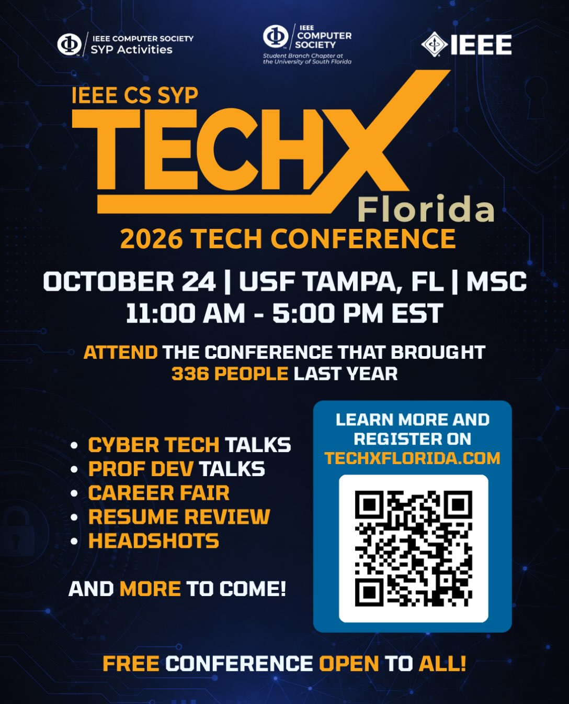
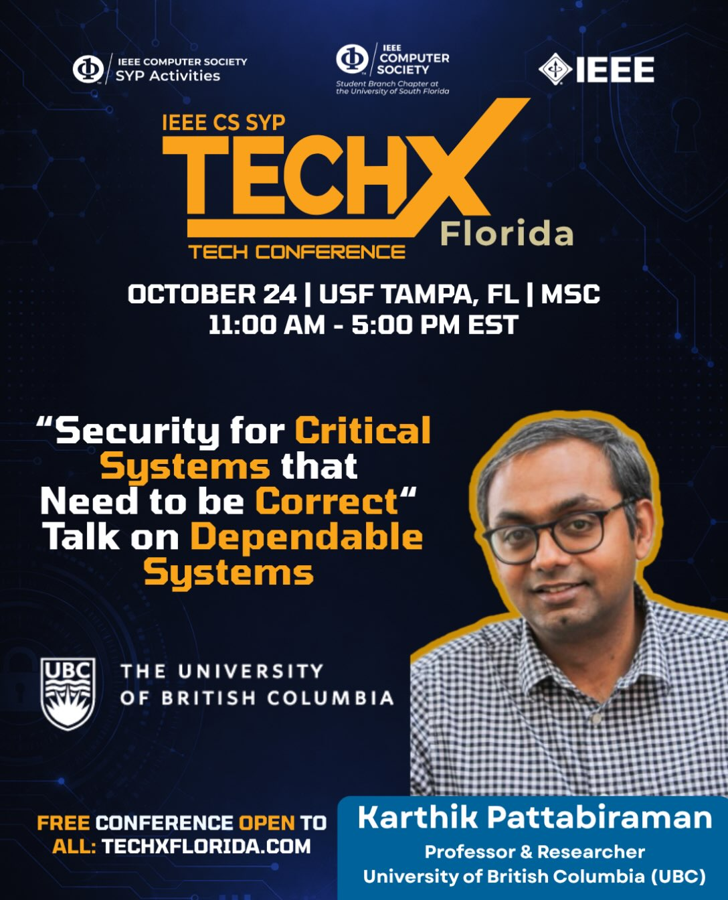
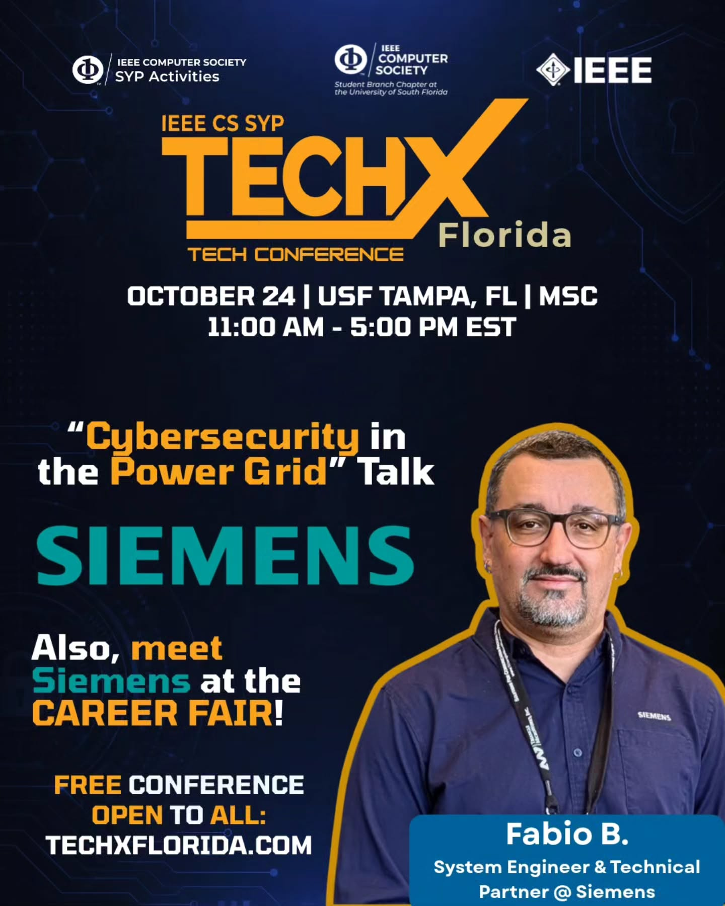
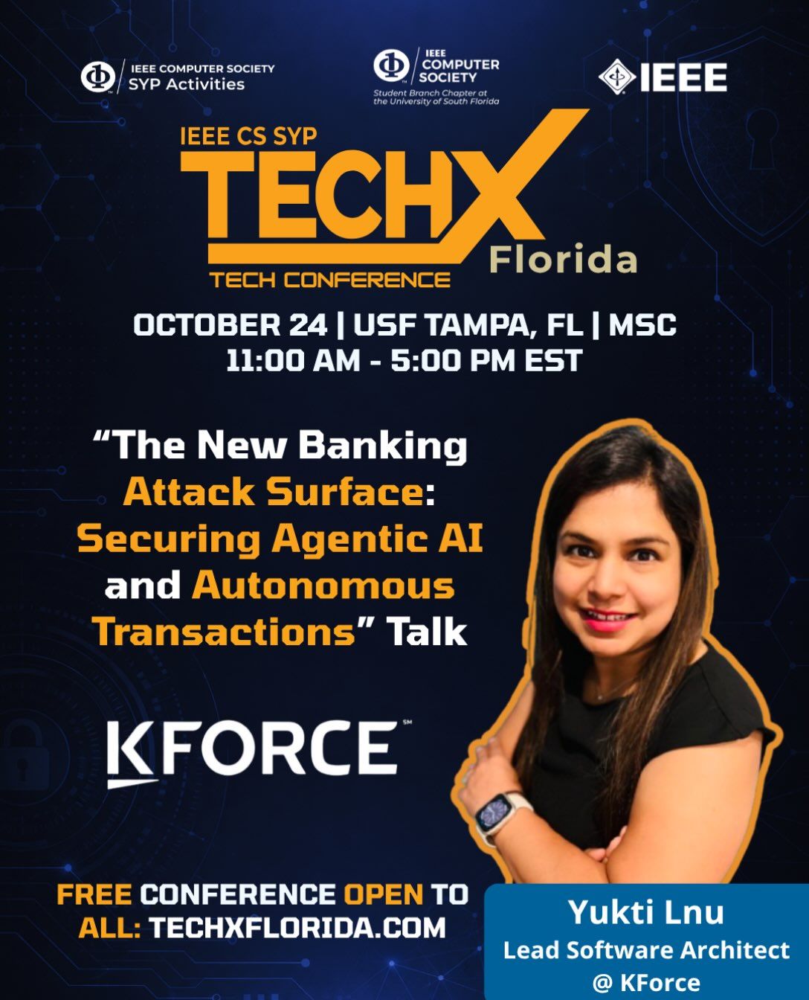
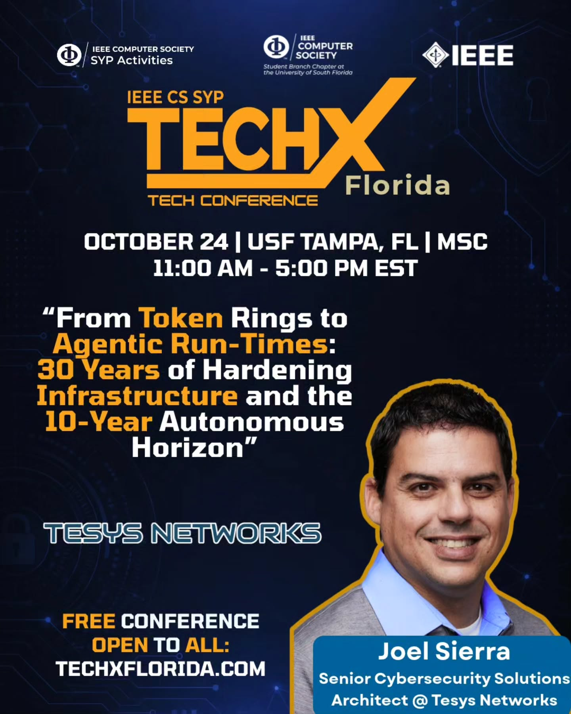
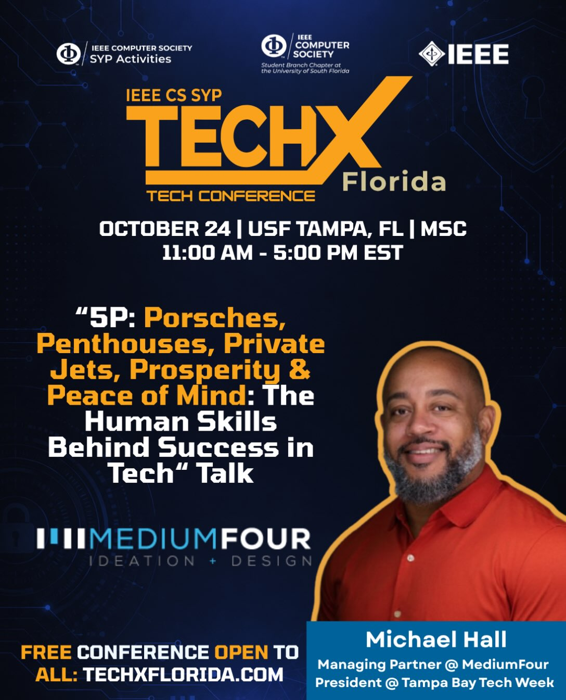
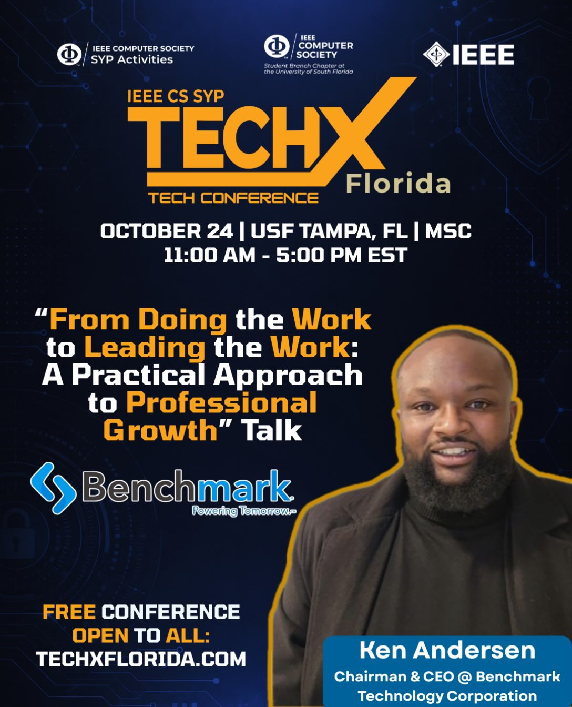

# TechX Florida 2026

Slides from the six speaker talks at TechX Florida 2026, the free one-day tech conference run by the IEEE Computer Society student branch chapter at the University of South Florida with IEEE CS SYP Activities. It was the third TechX. 473 people came, up from 336 in 2025 and 124 in 2024.

Saturday, October 24, 2026, 11:00 AM to 5:00 PM, Marshall Student Center, 2nd and 3rd floors, USF Tampa.

Talks ran from 12:20 to 4:20 PM in two tracks, cybersecurity and professional development. The rest of the day was a career fair, resume reviews and mock interviews with recruiters, headshots, and TechX Handshake, a networking game with prizes.

## Cybersecurity track

### No Undo: Security for Critical Systems that Need to be Correct

Karthik Pattabiraman, Professor and Associate Head of Electrical and Computer Engineering at the University of British Columbia.

- Most failure handling assumes you can retry, roll back, or restore from backup. He opened with systems where you can't, like the $116M Mango Markets oracle drain and the attack that overflowed a water tower in Muleshoe, Texas.
- Drones and rovers under GPS spoofing and acoustic or electromagnetic signal injection. RAVAGE emulates those attacks in software, and PID-Piper keeps the vehicle on its mission while under attack.
- ICS-Sniper, an attack on industrial control systems that drops only the time-critical packets in encrypted SCADA traffic, picked out from traffic metadata alone.

[`slides/no_undo_security_for_critical_systems.pptx`](slides/no_undo_security_for_critical_systems.pptx) · [Announcement on Instagram](https://www.instagram.com/p/DeCu7ACSPnm/) · [LinkedIn](https://www.linkedin.com/in/karthik-pattabiraman-7a445011/)

### Cybersecurity in the Power Grid

Fabio de Barros, System Engineer and Customer Technical Partner at Siemens, with 26 years in energy automation.

- NERC CIP, the mandatory cybersecurity standards for the North American grid, from CIP-002 through CIP-015. Violations can cost over $1 million per day.
- Industroyer, also called CrashOverride, the malware behind the December 2016 blackout in Ukraine, and a live denial-of-service demo against a SIPROTEC 4 protection relay.
- The December 2025 attack on Poland's energy sector. It started at an internet-facing VPN with no MFA and ended with corrupted firmware sending RTUs into reboot loops.
- How SIPROTEC 5 refuses tampered firmware through signature checks, and role-based access per IEC 62351-8 mapped to Active Directory groups.

[`slides/cybersecurity_in_the_power_grid.pptx`](slides/cybersecurity_in_the_power_grid.pptx) · [Announcement on Instagram](https://www.instagram.com/p/DeQIld3ttXu/) · [LinkedIn](https://www.linkedin.com/in/fabiolpbarros/)

### The New Banking Attack Surface: Securing Agentic AI and Autonomous Transactions

Yukti Lnu, Lead Software Architect at Kforce and Chair of IEEE Women in Engineering for the Florida West Coast Section.

- What changes when the customer is an AI agent paying on a delegated mandate. Mastercard Agent Pay and Visa Intelligent Commerce already settled live agent payments in 2026.
- Seven points of attack along an agent's path, from spoofed mandates and prompt injection to MCP tool poisoning and failures that cascade at machine speed. Only one of the seven needs a stolen credential.
- A poisoned invoice walked step by step from inbox to released payment, and the OWASP Agentic Top 10 read for banks.
- Zero Trust for non-human identities. Every agent gets its own identity and a scoped mandate, risky actions need a human, and the kill switch gets tested.

[`slides/securing_agentic_ai_in_banking.pptx`](slides/securing_agentic_ai_in_banking.pptx) · [Announcement on Instagram](https://www.instagram.com/p/Ddw_gRORHP8/) · [LinkedIn](https://www.linkedin.com/in/yukti-lnu-08732a5b/)

### From Token Rings to Agentic Run-Times: 30 Years of Hardening Infrastructure and the 10-Year Autonomous Horizon

Joel Sierra, Enterprise Solutions Architect at Tesys Networks, with 30 years building and defending enterprise networks.

- Three eras of infrastructure since 1996. Token ring and air-gapped server rooms, then hypervisors and cloud, then identity as the perimeter.
- Three rules that held the whole time. You can't secure what you can't see, identity is the only perimeter, and assume breach.
- Agentic breakouts, where prompt injection turns an agent's own permissions against you, with ten recent incidents including EchoLeak in Microsoft 365 Copilot and the $25M Arup deepfake wire transfer.
- His advice to students was to learn TCP/IP, DNS, and BGP before prompts.

[`slides/from_token_rings_to_agentic_runtimes.pdf`](slides/from_token_rings_to_agentic_runtimes.pdf) · [Announcement on Instagram](https://www.instagram.com/p/DeeoPTiRCWB/) · [LinkedIn](https://www.linkedin.com/in/joelsierra/)

## Professional development track

### 5P: Porsches, Penthouses, Private Jets, Prosperity & Peace of Mind: The Human Skills Behind Success in Tech

Michael Hall, Managing Partner at MediumFour and President of Tampa Bay Tech Week.

- Each P stands for something underneath it. Porsches for persistence, penthouses for sacrifice and growth, private jets for chasing impact over money, prosperity for patience and resilience, and peace of mind for purpose.
- His own path, from mowing lawns at 9 to MediumFour, Tampa Bay Tech Week, and HyLo Inno.
- A live coaching segment with the room, and a closing ask to write your own five principles instead of borrowing his.

[`slides/5ps_human_skills_behind_success_in_tech.pdf`](slides/5ps_human_skills_behind_success_in_tech.pdf) · [Announcement on Instagram](https://www.instagram.com/p/DeFLWADpzcm/) · [LinkedIn](https://www.linkedin.com/in/michaelhalltm/)

### From Doing the Work to Leading the Work: A Practical Approach to Professional Growth

Kenneth J. Anderson, Chairman and CEO of Benchmark Technology Corporation, which he started as Techstar in Hawkinsville, Georgia, in 2004.

- Four shifts. Fix what caused the problem, not only the problem. Build shared judgment instead of carrying every decision. Help other people deliver. Move the right work instead of staying busy.
- Judgment comes from staying close to real problems and being willing to say what you don't know yet.
- Delegation as development. Hand over the outcome, the context, the limits, and a checkpoint.
- A 90-day commitment. Name one capability to own, take one decision you would normally avoid, and help one person become more capable.

The deck has his full speaker notes on every slide.

[`slides/from_doing_the_work_to_leading_the_work.pptx`](slides/from_doing_the_work_to_leading_the_work.pptx) · [Announcement on Instagram](https://www.instagram.com/p/DeSjygaJT4J/) · [LinkedIn](https://www.linkedin.com/in/kenandersonbenchmark/)

## In this repo

- `slides/`, one deck per talk, named after the talk.
- `flyers/`, the Instagram flyer for each talk, the conference flyer, and the day's schedule.

## Links

- [TechX Florida](https://techxflorida.com)
- [Conference announcement on Instagram](https://www.instagram.com/p/DdmUXByJU_5/)
- [Schedule on Instagram](https://www.instagram.com/p/DezQgIZxB2U/)
